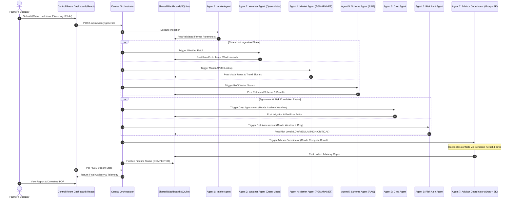

# Agricultural Advisory Control Room
## Group 20 – Multi-Agent AI System

An autonomous, production-grade agricultural intelligence control room powered by **Microsoft Semantic Kernel**, **Groq LLM Inference**, and a genuine **Shared Blackboard Architecture**.

---

## 1. System Overview

The **Agricultural Advisory Control Room** coordinates seven specialized autonomous AI agents to generate real-time agronomic advisories for Indian farmers. Rather than relying on rigid monolithic prompts or hardcoded frontend displays, all agents communicate through a central, persistent **Shared Blackboard memory bus** backed by SQLite.

### Key Capabilities
- **Decoupled Multi-Agent Architecture**: 7 discrete Python agent modules with isolated responsibilities and telemetry.
- **Genuine Shared Blackboard**: Thread-safe in-memory publish/subscribe event bus persisted to SQLite for auditable record-keeping.
- **RAG over Official Government Schemes**: Normalized TF-IDF and Cosine Vector Search over authentic policy documentation (PM-KISAN, PMFBY, KCC, PMKSY, Soil Health Card, State Diversification).
- **Live Meteorological Ingestion**: Open-Meteo API for real-time geocoding and 7-day numerical weather predictions (rainfall probability, wind velocity, temperature extremes).
- **Mandi Market Dynamics**: AGMARKNET APMC market benchmarks with automated trend calculations and Sell/Hold/Monitor decision signals.
- **Conflict-Resolving Advisor Coordinator**: Synthesizes all blackboard entries, reconciles competing recommendations (e.g. withholding irrigation before rainfall or during high winds), and generates a farmer-friendly advisory.
- **Official PDF Advisory Export**: Downloadable ReportLab PDF reports complete with official styling, risk warnings, and action checklists.

---

## 2. System Architecture Diagram

```
+----------------------------------------------------------------------------------------+
|                               FARMER INPUT INTERFACE                                   |
|       (Crop: Wheat | Location: Ludhiana, Punjab | Stage: Flowering | Area: 6.5 Ac)      |
+-------------------------------------------+--------------------------------------------+
                                            |
                                            v
+----------------------------------------------------------------------------------------+
|                                  AGENT 1: INTAKE AGENT                                 |
|             • Validates crop parameters, geographic scope & growth stage               |
|             • Publishes validated profile to Blackboard                                |
+-------------------------------------------+--------------------------------------------+
                                            |
                                            v
+========================================================================================+
|                       CENTRAL SHARED BLACKBOARD (CONTROL ROOM)                         |
|                 In-Memory Async Queue + SQLite Persistent Audit Table                  |
+========================================================================================+
               |                                |                               |
               v (Concurrent)                   v (Concurrent)                  v (Concurrent)
+-----------------------------+  +-----------------------------+  +------------------------------+
|   AGENT 2: WEATHER AGENT    |  |    AGENT 4: MARKET AGENT    |  |  AGENT 5: SCHEME AGENT (RAG) |
| • Open-Meteo satellite feed |  | • AGMARKNET APMC benchmarks |  | • Vector retrieval over docs |
| • Rain prob & wind hazards  |  | • 7-day trend analysis      |  | • PMFBY, PM-KISAN, KCC, PMKSY|
| • Posts weather to Board    |  | • Posts rates to Board      |  | • Posts schemes to Board     |
+-----------------------------+  +-----------------------------+  +------------------------------+
               |                                |                               |
               +--------------------------------+-------------------------------+
                                                |
                                                v
               +--------------------------------+-------------------------------+
               | (Consumes Weather + Intake)    | (Consumes Weather + Crop)     |
               v                                v                               |
+-----------------------------+  +-----------------------------+                |
|    AGENT 3: CROP AGENT      |  |  AGENT 6: RISK ALERT AGENT  |                |
| • Stage agronomics          |  | • Threat correlator         |                |
| • Moisture & nutrient guide |  | • LOW/MEDIUM/HIGH/CRITICAL  |                |
| • Posts actions to Board    |  | • Posts warnings to Board   |                |
+-----------------------------+  +-----------------------------+                |
               |                                |                               |
               +--------------------------------+-------------------------------+
                                                |
                                                v
+========================================================================================+
|                         AGENT 7: ADVISOR COORDINATOR                                   |
|         • Powered by Microsoft Semantic Kernel & Groq LLM (openai/gpt-oss-120b)        |
|         • Reconciles conflicts (Rain alert -> Postpone irrigation)                     |
|         • Formulates 5 required report sections in simple farmer-friendly language     |
+========================================================================================+
                                                |
                                                v
+----------------------------------------------------------------------------------------+
|                         FINAL ACTIONABLE FARMER ADVISORY                               |
|        1. Weather Overview  2. Risk Alert  3. Field Action  4. Mandi Analysis          |
|        5. Sell/Hold Signal  6. Govt Scheme  7. Eligibility  8. Action Plan             |
|                                                                                        |
|             [Download Official PDF]  •  [Inspect Agent Reasoning Trace]               |
+----------------------------------------------------------------------------------------+
```

---

## 3. Mermaid Sequence Diagram



---

## 4. Multi-Agent Roster & Responsibilities

| # | Agent Name | Display Name | Core Responsibility | Primary Data Source |
|---|------------|--------------|---------------------|---------------------|
| 1 | `intake_agent` | Intake Agent | Ingests, sanitizes, and validates farmer crop profiles, stage, and acreage. | Farmer Web Interface |
| 2 | `weather_agent` | Weather Agent | Retrieves satellite meteorology, rainfall probabilities, and wind velocities. | Open-Meteo NWP Forecast API |
| 3 | `crop_agent` | Crop Agent | Prescribes stage-specific irrigation, nutrition splits, and foliar spray schedules. | Agronomic Knowledge Base |
| 4 | `market_agent` | Market Agent | Analyzes wholesale APMC mandi prices, volume arrivals, and calculates Sell/Hold signals. | AGMARKNET APMC Benchmarks |
| 5 | `scheme_agent` | Scheme Agent (RAG) | Performs vector search over official government scheme documentation for direct subsidies. | Policy Knowledge Base (`/schemes`) |
| 6 | `risk_alert_agent` | Risk Alert Agent | Synthesizes crop sensitivity against weather threats and assigns threat levels. | Multi-factor Risk Matrix |
| 7 | `advisor_coordinator`| Advisor Coordinator | Resolves conflicting recommendations and synthesizes cohesive advice in farmer-friendly language. | Microsoft Semantic Kernel + Groq |

---

## 5. Technology Stack

### Frontend
- **Framework**: React.js 19 with Vite 8
- **Styling**: Tailwind CSS v4 with custom agricultural control room color tokens
- **Icons**: Lucide React
- **Visual Analytics**: Recharts (Responsive Line & Bar Charts)
- **API Client**: Axios with baseURL proxying

### Backend
- **Server**: Python 3.14 / 3.12, FastAPI, Uvicorn
- **AI Agent Framework**: Microsoft Semantic Kernel (`semantic-kernel` 1.47+)
- **LLM Provider**: Groq API (`openai/gpt-oss-120b`, fallback `qwen/qwen3.8-27b`)
- **RAG & Vector Storage**: Cosine Vector Engine with Normalized TF-IDF Embeddings
- **Relational Storage**: SQLite with persistent blackboard audit trails
- **PDF Engine**: ReportLab 5.1

---

## 6. Setup & Execution Instructions

### Prerequisites
- Python 3.10+ (Tested on Python 3.12 and 3.14)
- Node.js 18+ and npm

### Backend Installation

1. Navigate to the project root:
   ```bash
   cd c:\Users\rajes\OneDrive\Desktop\multiagent
   ```

2. (Optional) Create and activate a virtual environment:
   ```bash
   python -m venv venv
   # On Windows:
   .\venv\Scripts\activate
   # On Linux/macOS:
   source venv/bin/activate
   ```

3. Install backend dependencies:
   ```bash
   pip install -r backend/requirements.txt
   ```

4. Verify your `.env` configuration in `backend/.env`:
   ```ini
   GROQ_API_KEY=your_groq_api_key_here
   GROQ_MODEL=openai/gpt-oss-120b
   GROQ_FALLBACK_MODEL=qwen/qwen3.8-27b
   DATABASE_URL=sqlite:///./advisory_control_room.db
   PORT=8000
   HOST=0.0.0.0
   ENABLE_DEMO_FALLBACK=true
   ```

5. Run the backend tests:
   ```bash
   python -m unittest discover -s backend/tests
   ```

6. Start the FastAPI backend server:
   ```bash
   cd backend
   python -m uvicorn app.main:app --host 0.0.0.0 --port 8000 --reload
   ```
   *The backend will be available at `http://localhost:8000` (Swagger docs at `http://localhost:8000/docs`).*

### Frontend Installation

1. Navigate to the frontend directory:
   ```bash
   cd frontend
   ```

2. Install dependencies:
   ```bash
   npm install --legacy-peer-deps
   ```

3. Start the Vite development server:
   ```bash
   npm run dev
   ```
   *The control room dashboard will open at `http://localhost:5173`.*

---

## 7. Sample Demonstration Walkthrough

To demonstrate the full multi-agent pipeline during an academic evaluation:

1. Open the web dashboard at `http://localhost:5173`.
2. Navigate to **New Farmer Advisory** in the sidebar.
3. Click the amber button: **"Load Wheat Ludhiana Scenario"**:
   - **Crop**: Wheat
   - **Location**: Ludhiana, Punjab
   - **Growth Stage**: Flowering / Heading
   - **Land Area**: 6.5 Acres
   - **Irrigation**: Canal / Tubewell
4. Click **"GENERATE AI ADVISORY"**.
5. Observe the **Live Control Room Monitoring**:
   - The Intake Agent validates and posts to the Blackboard.
   - Weather, Market, and Scheme Agents execute concurrently.
   - Crop Agent evaluates moisture needs at flowering; Risk Alert Agent assesses rain/wind risks.
   - Advisor Coordinator resolves the conflict (e.g. holds irrigation before rain) and synthesizes the advice.
6. Review the **Final Advisory Report**:
   - Check the Meteorological forecast and Mandi price trend chart.
   - Review the RAG-retrieved PMFBY scheme with official portal link.
   - Click **"Download Advisory as PDF"** to generate the official printable advisory document.
   - Click **"Agent Reasoning / Trace"** to view raw blackboard payloads and RAG cosine similarity scores.

---

## 8. REST API Reference

| Method | Endpoint | Description |
|--------|----------|-------------|
| `POST` | `/api/advisory/generate` | Initiates the 7-agent workflow for a farmer request. |
| `GET` | `/api/advisory/{request_id}` | Retrieves final advisory report and workflow status. |
| `GET` | `/api/advisory/{request_id}/pdf` | Generates and downloads the advisory as an official PDF. |
| `GET` | `/api/agents/status/{request_id}` | Returns execution status, runtime ms, and outputs for all 7 agents. |
| `GET` | `/api/blackboard/{request_id}` | Returns all structured entries published to the shared blackboard. |
| `GET` | `/api/history` | Returns historical farmer advisories stored in SQLite. |
| `GET` | `/api/history/stats` | Aggregated statistics for the control room overview cards. |
| `GET` | `/api/schemes` | Returns catalog of government schemes from the RAG knowledge base. |
| `GET` | `/api/schemes/search?q={query}` | Performs semantic search across scheme documents. |
| `GET` | `/api/health` | Service health check and LLM configuration telemetry. |

---

## 9. Academic Group Information

- **Project**: Agricultural Advisory Control Room
- **Group**: Group 20 – Multi-Agent AI System
- **Focus**: Framework-based Multi-Agent Coordination, Shared Blackboard Architecture, RAG over Government Policy Documents.
